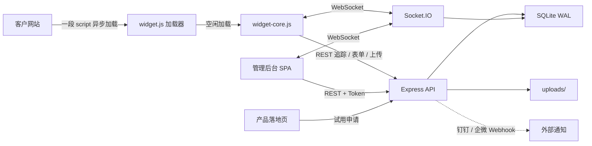

# 架构、数据库与接口规划

## 1. 系统上下文

单进程单端口同时承载落地页、后台 SPA、挂件脚本、REST API、WebSocket 与上传文件，便于预览与横向扩容前的最小部署。

## 2. 后端模块

| 模块 | 文件 | 职责 |
| --- | --- | --- |
| 入口 | `server/index.js` | 安全头、JSON、静态资源、路由、错误处理、Socket.IO |
| 数据 | `server/db.js` + `schema.sql` | 建表、查询封装、事务 |
| 认证 | `server/auth.js` | scrypt、HMAC Token、角色校验、特性门禁、API Key |
| 公开 | `routes/public.js` | 访客配置、会话、追踪、触发、表单、离线留言、评价、录屏、上传、广告拦截 |
| 实时 | `socket.js` | 访客与客服双向消息、抢单、转接、备注、输入预览、关闭与摘要 |
| 会话 | `routes/conversations.js` | 列表、详情、筛选、状态与标签 |
| 访客 | `routes/visitors.js` | 列表、画像、标签、编辑、合并、拉黑、导出 |
| 线索 | `routes/leads.js` | 线索池、状态流转、分配、跟进、CSV 导出 |
| 报表 | `routes/reports.js` | 概览、来源、漏斗、绩效、区域、流失 |
| 配置 | `routes/config.js` | 站点、挂件、表单、规则、知识库、公告、黑名单、话术、标签、录屏 |
| 系统 | `routes/settings.js` | 团队、品牌、套餐、API Key、通知渠道、日志、AI |
| 开放 API | `routes/external.js` | 企业版 `x-api-key` 接口 |
| 落地页 | `routes/landing.js` | 套餐、健康检查、试用申请 |

## 3. 数据库设计

所有业务表都包含 `tenant_id`。站点级数据同时包含 `site_id`。查询入口统一从 Token 或 site key 推导租户，避免客户端传入任意 `tenant_id`。

### 3.1 租户与账号

| 表 | 关键字段 | 说明 |
| --- | --- | --- |
| `tenants` | plan, status, brand_name, hide_branding, custom_domain | 套餐、白标、停用 |
| `users` | tenant_id, email, password_hash, role, status | RBAC：admin/operator/agent |
| `sites` | tenant_id, site_key, widget_config, tracking_enabled, compliance_enabled | 多站点与挂件配置 |
| `api_keys` | tenant_id, key, enabled | 企业版开放 API |
| `audit_logs` | tenant_id, user_id, action, target, ip | 审计 |

### 3.2 访客与行为

| 表 | 关键字段 | 说明 |
| --- | --- | --- |
| `visitors` | vid, fingerprint, province, source, utm_*, intent_score, tags, tracking_consent, merged_into | 设备回访按 fingerprint 合并 |
| `visitor_sessions` | visitor_id, entry_page, duration_ms, page_count | 一次访问 |
| `pageviews` | visitor_id, session_id, url, dwell_ms, seq | 页面轨迹与停留 |
| `events` | type, name, payload, url | 点击、滚动、广告拦截、打开挂件 |
| `visitor_tags` | visitor_id, tag_id | 手动与自动标签 |

访客身份优先级：`localStorage vid` → 服务端 `fingerprint` 合并 → 新建设备档案。合并后的旧档案标记 `merged_into` 并停止计入列表。

### 3.3 会话与消息

| 表 | 关键字段 | 说明 |
| --- | --- | --- |
| `conversations` | visitor_id, agent_id, status, rating, unread_*, first_response_ms, ai_* | 会话状态与 AI 摘要 |
| `messages` | conversation_id, sender_type, type, content, file_url, is_private | 私有备注 `is_private=1` 不下发访客 |
| `canned_replies` | tenant_id, title, content | 快捷话术 |
| `recordings` | visitor_id, conversation_id, file_url | 访客录屏 |

消息类型：`text / image / file / recording / note / rating / form`。

### 3.4 线索与表单

| 表 | 关键字段 | 说明 |
| --- | --- | --- |
| `forms` | type(prechat/trigger/lead/offline), fields JSON | 表单定义 |
| `form_submissions` | form_id, visitor_id, data JSON | 提交记录 |
| `leads` | source, status(new/following/won/invalid), owner_id, score | 统一线索池 |
| `follow_ups` | lead_id, user_id, content | 跟进记录 |

### 3.5 运营与配置

| 表 | 说明 |
| --- | --- |
| `faq_categories` / `faqs` / `knowledge_files` | 自助知识库与附件 |
| `rules` | trigger/keyword/sensitive 三类规则，conditions/actions JSON |
| `rule_logs` | 规则触发与拦截记录 |
| `announcements` | 顶部/侧边公告 |
| `blacklist` | IP / 访客 ID 拦截 |
| `notification_channels` | 钉钉/企微 Webhook 与事件订阅 |
| `notifications` | 站内通知 |
| `tags` | 访客标签字典 |

## 4. 关键流程

### 4.1 挂件加载

首屏只承担约 4KB 加载器。Socket.IO 客户端进一步延迟到访客首次打开会话。

### 4.2 追踪与合规

1. 首次访问展示隐私提示（站点开启时）
2. 同意 → `/api/public/consent` 写入 1 → 启动会话与页面浏览上报
3. 拒绝 → 写入 0 → 停止轨迹、点击、来源上报；仍可创建匿名身份进行聊天
4. 站点 `tracking_enabled=0` → 服务端直接拒绝详细追踪入库
5. 会话始终可初始化：挂件在追踪关闭时调用轻量 `/session` 只建立身份，不采集轨迹

### 4.3 触发规则

客户端每 4.5 秒评估一次本地条件（页面、停留、滚动、无操作、退出意图、设备、新/回访），命中后调用 `/api/public/trigger-check` 由服务端二次校验、计数并返回动作。这样既保证即时性，也避免绕过套餐权限。

### 4.4 实时消息

- 访客 `visitor:init`：复用 24 小时内未关闭会话或新建会话
- 访客消息：频率限制（20 条 / 30 秒）→ 敏感词 → 入库 → 广播 → 关键词自动回复 → AI 机器人兜底
- 客服消息：未归属时自动接管，首次回复计算 `first_response_ms`
- 私有备注只广播到 `tenant:*` 房间，不进入 `conv:*`
- 关闭会话：企业版生成 AI 摘要、需求、建议与自动标签

## 5. REST 接口规划

### 5.1 公开接口

| 方法 | 路径 | 说明 |
| --- | --- | --- |
| GET | `/api/public/config` | 挂件配置与套餐能力 |
| POST | `/api/public/session` | 访客身份与会话 |
| POST | `/api/public/track` | 页面、停留、点击、滚动、广告拦截 |
| POST | `/api/public/trigger-check` | 触发规则校验 |
| POST | `/api/public/form/:id` | 表单提交并生成线索 |
| POST | `/api/public/offline` | 离线留言 |
| POST | `/api/public/rating` | 满意度 |
| POST | `/api/public/upload` | 访客附件 |
| POST | `/api/public/recording` | 访客录屏 |
| POST | `/api/public/consent` | 同意/拒绝追踪 |
| POST | `/api/public/blacklist-check` | 黑名单校验 |
| POST | `/api/public/adblock` | 拦截上报 |

### 5.2 后台接口

| 分组 | 代表路径 |
| --- | --- |
| 认证 | `POST /api/auth/login`、`GET /api/auth/me`、`POST /api/auth/password` |
| 概览 | `GET /api/dashboard/overview` |
| 会话 | `GET /api/conversations`、`GET /api/conversations/:id`、`PATCH /api/conversations/:id` |
| 访客 | `GET /api/visitors`、`GET /api/visitors/:id`、`PATCH /api/visitors/:id`、`POST /api/visitors/:id/tags`、`POST /api/visitors/:id/merge` |
| 线索 | `GET/POST /api/leads`、`PATCH /api/leads/:id`、`POST /api/leads/:id/followups`、`GET /api/leads/export.csv` |
| 报表 | `/api/reports/sources`、`/funnel`、`/agents`、`/geo`、`/churn` |
| 站点 | `GET/POST /api/sites`、`PATCH /api/sites/:id`、`POST /api/sites/:id/rotate-key` |
| 表单 | `GET/POST /api/forms`、`PATCH/DELETE /api/forms/:id` |
| 规则 | `GET/POST /api/rules`、`PATCH/DELETE /api/rules/:id` |
| 知识库 | `/api/faqs`、`/api/faq-categories`、`/api/knowledge-files` |
| 运营 | `/api/announcement`、`/api/blacklist`、`/api/canned-replies`、`/api/tags` |
| 团队 | `/api/users` |
| 系统 | `/api/settings`、`/api/billing`、`/api/api-keys`、`/api/notification-channels`、`/api/notifications`、`/api/audit-logs` |
| AI | `/api/ai/overview`、`/api/ai/summary/:id`、`/api/ai/translate`、`/api/ai/test-answer` |

### 5.3 开放 API（企业版）

`x-api-key` 认证，租户由 Key 推导：

| 方法 | 路径 |
| --- | --- |
| GET | `/api/v1/stats` |
| GET / POST | `/api/v1/leads` |
| PATCH | `/api/v1/leads/:id` |
| GET | `/api/v1/conversations` |
| GET | `/api/v1/conversations/:id/messages` |
| GET | `/api/v1/visitors` |

## 6. Socket 事件

| 方向 | 事件 | 说明 |
| --- | --- | --- |
| 访客 | `visitor:init` | 建立/恢复会话 |
| 访客 | `visitor:message` | 发送消息 |
| 访客 | `visitor:typing` | 输入中与草稿预览 |
| 访客 | `visitor:read` | 已读 |
| 客服 | `auth:agent` | Token 认证 |
| 客服 | `agent:join` | 加入会话房间 |
| 客服 | `agent:message` / `agent:note` | 回复 / 私有备注 |
| 客服 | `conversation:claim` / `transfer` / `close` / `reopen` | 会话流转 |
| 客服 | `agent:typing` | 客服输入中 |
| 服务端 | `message:new` / `note:new` / `conversation:update` / `conversation:new` / `conversation:closed` | 推送 |
| 服务端 | `presence:agents` / `presence:visitors` / `notification:new` | 在线与通知 |

## 7. 安全与风控

| 风险 | 控制 |
| --- | --- |
| 越权 | JWT 式 HMAC Token + 每次请求校验租户；角色校验；套餐特性门禁 |
| 刷消息 | 访客 20 条/30 秒、客服 90 条/分钟、表单/上传/会话独立限频 |
| 恶意内容 | 敏感词规则拦截并记录，不上屏 |
| 爬虫/骚扰 | IP 与访客 ID 黑名单，JS 端不渲染 |
| 文件风险 | 扩展名白名单、随机文件名、单文件大小限制 |
| 数据过度采集 | 站点级追踪总开关 + 访客拒绝 + 隐私提示 |
| 审计 | 登录、配置变更、导出、成员管理写审计日志 |
| 上传目录 | 静态目录相互独立，禁止执行脚本 |

## 8. 前端结构

- 后台 SPA 使用 hash 路由，页面注册表 `Admin.pages`，每个页面独立脚本按分组加载
- 页面权限在路由层校验角色与 feature，接口层再次校验
- 所有请求统一 `Admin.api`，401 自动回登录、PLAN_LOCKED 自动弹升级
- 图表为原生 SVG，无图表库依赖
- 挂件使用 Shadow DOM 隔离宿主 CSS，支持 PC / 移动端 / 微信内置浏览器

## 9. 扩展建议

1. 数据库替换为 PostgreSQL，保留 `tenant_id` + 行级安全策略
2. Socket.IO 使用 Redis Adapter 支持多实例
3. 消息、上传走对象存储与 CDN，数据库仅存元数据
4. AI 与翻译接入大模型服务，保留当前启发式作为降级
5. 自定义域名接入网关与自动证书
6. 计费接入支付与订阅状态机，替换演示的 `change-plan`
