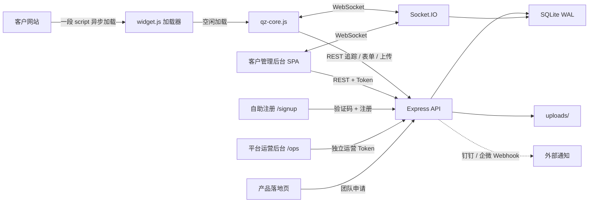
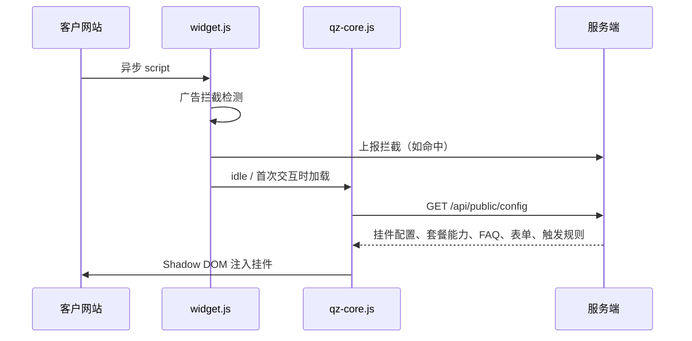
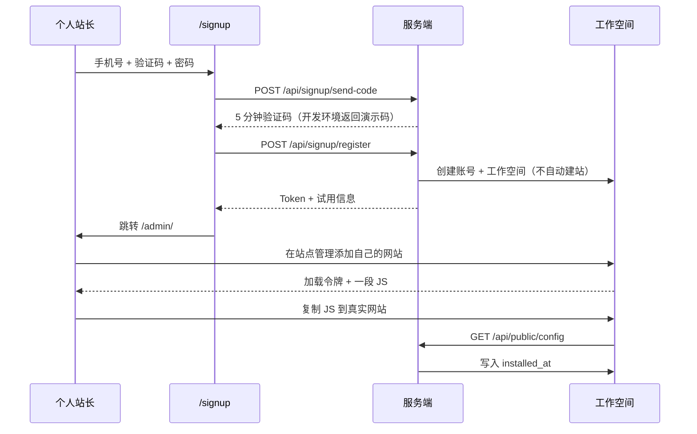
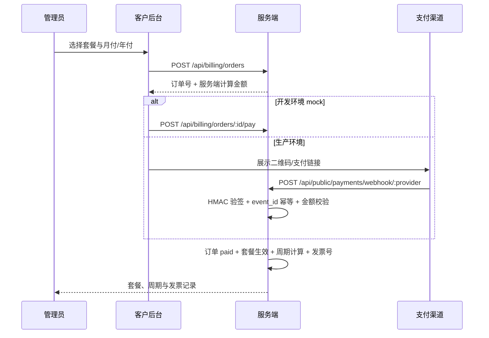
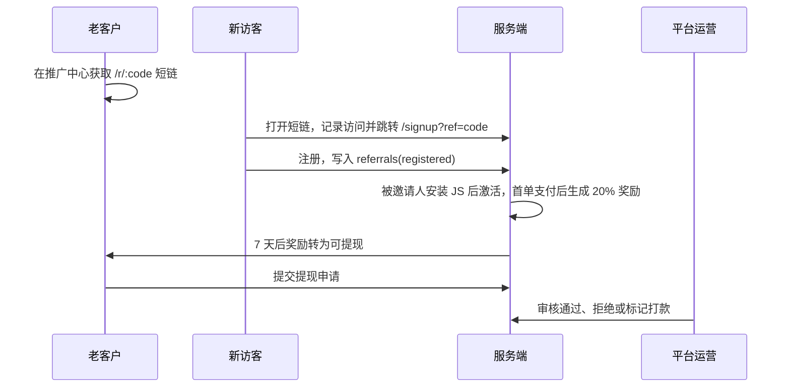

# 架构、数据库与接口规划

## 1. 系统上下文

单进程单端口同时承载落地页、后台 SPA、挂件脚本、REST API、WebSocket 与上传文件，便于预览与横向扩容前的最小部署。

## 2. 后端模块

| 模块 | 文件 | 职责 |
| --- | --- | --- |
| 入口 | `server/index.js` | 安全头、JSON、静态资源、路由、错误处理、Socket.IO |
| 数据 | `server/db.js` + `schema.sql` | 建表、查询封装、事务 |
| 认证 | `server/auth.js` | scrypt、HMAC Token、客户 RBAC、平台运营 RBAC、特性门禁、API Key |
| 注册 | `routes/signup.js` | 短信验证码、账号创建、14 天试用；站点由客户登录后添加 |
| 引导 | `routes/onboarding.js` | 安装检测、首条会话、首条线索与激活进度 |
| 运营 | `routes/ops.js` | 平台账号、工作空间、申请线索、订单收入、支持工单、风控、审计 |
| 订阅 | `services/billing.js` + `routes/payments.js` | 订单计价、模拟支付、回调验签、幂等开通、续费与降级 |
| 工单 | `routes/support.js` | 客户提交、追加回复、关闭工单；运营后台回复与状态流转 |
| PQL | `services/pql.js` | 安装、访客、会话、线索与团队成员阈值自动生成销售线索 |
| 推广 | `services/referral.js` + `routes/referral.js` | 推广码、短链归因、首单佣金、奖励结算与提现 |
| 国际化 | `public/i18n.js` + `widget-core.js` 语言包 | 简中/繁中/英/日/韩核心界面与挂件静态文案 |
| 开通 | `services/provision.js` | 账号 + 工作空间 + 可选站点的事务化开通 |
| 生命周期 | `services/lifecycle.js` | 试用到期降级免费版并保留数据 |
| 公开 | `routes/public.js` | 访客配置、会话、追踪、触发、表单、离线留言、评价、录屏、上传、广告拦截 |
| 实时 | `socket.js` | 访客与客服双向消息、抢单、转接、备注、输入预览、关闭与摘要 |
| 会话 | `routes/conversations.js` | 列表、详情、筛选、状态与标签 |
| 访客 | `routes/visitors.js` | 列表、画像、标签、编辑、合并、拉黑、导出 |
| 线索 | `routes/leads.js` | 线索池、状态流转、分配、跟进、CSV 导出 |
| 报表 | `routes/reports.js` | 概览、来源、漏斗、绩效、区域、流失 |
| 配置 | `routes/config.js` | 站点、挂件、表单、规则、知识库、公告、黑名单、话术、标签、录屏 |
| 系统 | `routes/settings.js` | 团队、品牌、套餐、API Key、通知渠道、日志、AI |
| 开放 API | `routes/external.js` | 企业版 `x-api-key` 接口 |
| 落地页 | `routes/landing.js` | 套餐、健康检查、团队申请（进入平台线索池） |

## 3. 数据库设计

所有业务表都包含 `tenant_id`。站点级数据同时包含 `site_id`。查询入口统一从 Token 或 site key 推导租户，避免客户端传入任意 `tenant_id`。

### 3.1 租户与账号

| 表 | 关键字段 | 说明 |
| --- | --- | --- |
| `accounts` | phone, email, password_hash, status, signup_source, referral_code, locale, risk_score | 登录身份、推广码与语言偏好 |
| `tenants` | name, plan, plan_status, trial_*, signup_source, risk_score, onboarding_state | 工作空间、套餐、试用与激活状态 |
| `users` | tenant_id, account_id, email, phone, role, status | 账号在工作空间内的成员关系与 RBAC |
| `sites` | tenant_id, site_key, loader_token, installed_at, last_widget_ping_at | 客户网站、加载令牌与安装检测 |
| `platform_users` | email, password_hash, role | 平台运营独立账号 |
| `applications` | phone, company, status, owner_id, tenant_id, account_id | 平台销售线索池 |
| `application_activities` | application_id, platform_user_id, content | 销售跟进时间线 |
| `sms_codes` | phone, code_hash, expires_at, attempts | 注册验证码 |
| `platform_audit_logs` | platform_user_id, action, target, detail, ip | 平台运营审计 |
| `orders` | order_no, tenant_id, plan, cycle, amount_cents, status, provider, invoice_no | 自助订单与发票记录 |
| `payment_events` | event_id, order_id, amount_cents, status, raw | 支付回调幂等与审计 |
| `support_tickets` | tenant_id, subject, category, priority, status | 客户支持工单 |
| `referrals` | referrer_account_id, referred_account_id, code, status | 推广归因与生命周期 |
| `referral_visits` | code, ip, ua | 邀请短链访问统计 |
| `referral_rewards` | referrer_account_id, referral_id, order_id, amount_cents, status | 首单佣金与结算状态 |
| `referral_withdrawals` | account_id, amount_cents, status | 提现申请与运营审核 |
| `ticket_messages` | ticket_id, sender_type, sender_id, content | 工单对话 |
| `api_keys` | tenant_id, key, enabled | 企业版开放 API |
| `audit_logs` | tenant_id, user_id, action, target, ip | 客户侧审计 |

### 3.2 访客与行为

| 表 | 关键字段 | 说明 |
| --- | --- | --- |
| `visitors` | vid, fingerprint, province, source, utm_*, intent_score, tags, tracking_consent, merged_into | 设备回访按 fingerprint 合并 |
| `visitor_sessions` | visitor_id, entry_page, duration_ms, page_count | 一次访问 |
| `pageviews` | visitor_id, session_id, url, dwell_ms, seq | 页面轨迹与停留 |
| `events` | type, name, payload, url | 点击、滚动、广告拦截、打开挂件 |
| `visitor_tags` | visitor_id, tag_id | 手动与自动标签 |

访客身份优先级：`localStorage vid` → 服务端 `fingerprint` 合并 → 新建设备档案。合并后的旧档案标记 `merged_into` 并停止计入列表。

### 3.3 会话与消息

| 表 | 关键字段 | 说明 |
| --- | --- | --- |
| `conversations` | visitor_id, agent_id, status, rating, unread_*, first_response_ms, ai_* | 会话状态与 AI 摘要 |
| `messages` | conversation_id, sender_type, type, content, file_url, is_private | 私有备注 `is_private=1` 不下发访客 |
| `canned_replies` | tenant_id, title, content | 快捷话术 |
| `recordings` | visitor_id, conversation_id, file_url | 访客录屏 |

消息类型：`text / image / file / recording / note / rating / form`。

### 3.4 线索与表单

| 表 | 关键字段 | 说明 |
| --- | --- | --- |
| `forms` | type(prechat/trigger/lead/offline), fields JSON | 表单定义 |
| `form_submissions` | form_id, visitor_id, data JSON | 提交记录 |
| `leads` | source, status(new/following/won/invalid), owner_id, score | 统一线索池 |
| `follow_ups` | lead_id, user_id, content | 跟进记录 |

### 3.5 运营与配置

| 表 | 说明 |
| --- | --- |
| `faq_categories` / `faqs` / `knowledge_files` | 自助知识库与附件 |
| `rules` | trigger/keyword/sensitive 三类规则，conditions/actions JSON |
| `rule_logs` | 规则触发与拦截记录 |
| `announcements` | 顶部/侧边公告 |
| `blacklist` | IP / 访客 ID 拦截 |
| `notification_channels` | 钉钉/企微 Webhook 与事件订阅 |
| `notifications` | 站内通知 |
| `tags` | 访客标签字典 |

### 3.6 账号、工作空间与双线运营

账号与工作空间分离：`accounts` 是登录身份，`users` 是账号在某个 `tenant` 内的成员关系。一个人可以加入多个工作空间，登录返回默认工作空间，并可通过 `/api/auth/switch` 切换。

平台运营数据与客户数据分域：

- 客户后台 `/admin/` 只看到自己工作空间内的会话、访客、客户自己的线索、报表与配置。
- 平台运营后台 `/ops/` 管理注册账号、工作空间、试用/订阅、申请线索、风控与平台成员。
- 申请表单进入 `applications`，不写入任何客户的 `leads`。
- 平台 Token 使用独立 `realm=ops`，不能访问客户接口；客户 Token 也不能访问运营接口。

## 4. 关键流程

### 4.1 挂件加载

首屏只承担约 4KB 加载器。每个站点有独立的 32 位十六进制 `loader_token`，嵌入地址形如 `/qz.js?<token>`，不暴露 `key` 查询参数。服务端按令牌注入 Site Key，再从加载器自己的 `script.src` 推导插件基址，因此嵌入代码必须是绝对 URL；后台根据请求的 `Host`、`X-Forwarded-Proto`、`X-Forwarded-Host`、`X-Forwarded-Prefix` 生成，也可用 `PUBLIC_BASE` 覆盖。`/api/public/*` 返回跨域头，客户网站可以从其他域名直接访问。

`/qz.js` 与 `/qz-core.js` 只接受脚本上下文：`Sec-Fetch-Dest=script`，或在没有该头时要求存在 `Referer`。直接打开返回 404。加载器除首行版权头外不包含注释。Socket.IO 客户端进一步延迟到访客首次打开会话。

### 4.2 追踪控制

1. 挂件加载后自动启动会话与页面追踪，不再展示隐私提示条。
2. 站点 `tracking_enabled=0` → 服务端直接拒绝详细追踪入库。
3. 会话始终可初始化：挂件在追踪关闭时调用轻量 `/session` 只建立身份，不采集轨迹。
4. 隐私提示与访客同意流程暂不启用，等产品稳定后再作为独立能力接入。

### 4.3 触发规则

客户端每 4.5 秒评估一次本地条件（页面、停留、滚动、无操作、退出意图、设备、新/回访），命中后调用 `/api/public/trigger-check` 由服务端二次校验、计数并返回动作。这样既保证即时性，也避免绕过套餐权限。

### 4.4 实时消息

- 访客 `visitor:init`：复用 24 小时内未关闭会话或新建会话
- 访客消息：频率限制（20 条 / 30 秒）→ 敏感词 → 入库 → 广播 → 关键词自动回复 → AI 机器人兜底
- 客服消息：未归属时自动接管，首次回复计算 `first_response_ms`
- 私有备注只广播到 `tenant:*` 房间，不进入 `conv:*`
- 关闭会话：企业版生成 AI 摘要、需求、建议与自动标签

### 4.5 自助注册与激活

激活判定是“添加网站、安装 JS 后收到首条会话”。注册只负责账号，站点由客户在后台自行添加。

### 4.6 销售申请转工作空间

1. 落地页团队表单写入 `applications`，状态 `new`。
2. 运营后台分配销售、记录跟进、修改状态。
3. 点击“转为工作空间”后，按手机号/邮箱复用或创建账号，再创建工作空间；客户登录后添加自己的网站。
4. 新账号返回一次性临时密码；已有账号直接增加成员关系。
5. 申请记录关联 `tenant_id` 与 `account_id`，状态改为 `won`。

### 4.7 自助订阅与支付回调

订单金额只由服务端按 `plans.js` 计算，客户端传价格无效。已支付订单生成 `invoice_no`；到期未续费先进入 7 天宽限期（`past_due`），仍未续费则降级免费版；取消续费会在当前周期结束后直接降级。

### 4.8 PQL 自动转销售

生命周期任务每小时检查已安装 JS 的工作空间：访客数 ≥ 50，且会话 ≥ 5 或线索 ≥ 2 时，生成 `applications.source='pql'` 的销售线索，按未关闭线索数分配给销售。30 天内已有未关闭 PQL 时不重复创建。

### 4.9 支持工单

1. 客户后台提交工单，写入 `support_tickets` 与首条 `ticket_messages`。
2. 平台运营在 `/ops/` 回复；状态变为 `pending`，客户收到站内通知。
3. 客户追加回复后状态回到 `open`。
4. 双方可标记已解决/关闭；运营可调整优先级。

### 4.10 推广激励

奖励只按被邀请人首次付费订单计算，退款订单作废；提现最低 100 元，由运营人工审核。推广数据独立于客户的线索 CRM。

### 4.11 国际化

`public/i18n.js` 提供五种语言：`zh-CN`、`zh-TW`、`en`、`ja`、`ko`。落地页、注册页、后台登录/导航、个人资料和公开推广页使用 `data-i18n` 与 `I18N.t()`；后台语言选择写入 `accounts.locale` 并持久化。访客挂件使用站点配置 `widget.locale`，静态 UI 文案来自 `widget-core.js` 内置语言包，客户输入、知识库与客服消息保持原文。

## 5. REST 接口规划

### 5.1 公开接口

| 方法 | 路径 | 说明 |
| --- | --- | --- |
| POST | `/api/signup/send-code` | 发送注册验证码 |
| POST | `/api/signup/register` | 注册并创建工作空间（不自动建站） |
| GET | `/qz.js?<token>` | 按站点令牌返回加载器，仅允许脚本上下文 |
| GET | `/qz-core.js` | 挂件内核，仅允许脚本上下文 |
| GET | `/api/public/config` | 挂件配置与套餐能力；正式站点自动记录安装时间 |
| POST | `/api/public/payments/webhook/:provider` | 支付回调，HMAC 验签、金额校验与 event_id 幂等 |
| POST | `/api/public/session` | 访客身份与会话 |
| POST | `/api/public/track` | 页面、停留、点击、滚动、广告拦截 |
| POST | `/api/public/trigger-check` | 触发规则校验 |
| POST | `/api/public/form/:id` | 表单提交并生成线索 |
| POST | `/api/public/offline` | 离线留言 |
| POST | `/api/public/rating` | 满意度 |
| POST | `/api/public/upload` | 访客附件 |
| POST | `/api/public/recording` | 访客录屏 |
| POST | `/api/public/blacklist-check` | 黑名单校验 |
| POST | `/api/public/adblock` | 拦截上报 |

### 5.2 运营推广接口

| 方法 | 路径 | 说明 |
| --- | --- | --- |
| GET | `/api/ops/referrals` | 推荐关系、奖励、提现与汇总 |
| PATCH | `/api/ops/referral-withdrawals/:id` | 通过、拒绝或标记打款 |

### 5.3 运营接口

| 方法 | 路径 | 说明 |
| --- | --- | --- |
| POST | `/api/ops/auth/login` | 平台运营登录 |
| GET | `/api/ops/overview` | 注册、激活、试用、申请与风险指标 |
| GET/PATCH | `/api/ops/accounts` | 客户账号检索、停用与风险标记 |
| GET/PATCH | `/api/ops/workspaces` | 工作空间、套餐、试用与停用 |
| GET/PATCH | `/api/ops/applications` | 申请线索、状态、负责人与跟进 |
| POST | `/api/ops/applications/:id/convert` | 申请转工作空间 |
| GET | `/api/ops/subscriptions` | 套餐分布、试用与临期 |
| GET | `/api/ops/risk` | 高风险账号、工作空间与同 IP 注册 |
| GET/POST/PATCH | `/api/ops/team` | 平台成员管理（超级管理员） |
| GET | `/api/ops/audit-logs` | 平台操作审计 |

### 5.4 订阅与工单

| 方法 | 路径 | 说明 |
| --- | --- | --- |
| GET | `/api/billing` | 套餐、用量、订阅、订单与发票 |
| POST | `/api/billing/orders` | 创建订单（服务端计价） |
| POST | `/api/billing/orders/:id/pay` | 开发环境模拟支付 |
| POST | `/api/billing/orders/:id/cancel` | 取消待支付订单 |
| POST | `/api/billing/downgrade` | 降级免费版或预约到期降级 |
| POST | `/api/billing/resume` | 取消到期降级设置 |
| POST | `/api/billing/contact-sales` | 企业版/定制咨询转销售线索 |
| GET | `/api/referral` | 推广中心：链接、归因、奖励、提现与余额 |
| POST | `/api/referral/withdrawals` | 提交推广提现申请（最低 ¥100） |
| GET | `/r/:code` | 推广短链，记录访问并跳转注册 |
| GET/POST | `/api/support/tickets` | 客户工单列表与新建 |
| GET | `/api/support/tickets/:id` | 工单详情与消息 |
| POST | `/api/support/tickets/:id/messages` | 客户追加回复 |
| PATCH | `/api/support/tickets/:id` | 标记解决/关闭 |
| GET/PATCH | `/api/ops/tickets` | 运营工单列表、状态与优先级 |
| POST | `/api/ops/tickets/:id/messages` | 运营回复工单 |

### 5.5 后台接口

| 分组 | 代表路径 |
| --- | --- |
| 认证 | `POST /api/auth/login`、`GET /api/auth/me`、`POST /api/auth/password` |
| 概览 | `GET /api/dashboard/overview` |
| 会话 | `GET /api/conversations`、`GET /api/conversations/:id`、`PATCH /api/conversations/:id` |
| 访客 | `GET /api/visitors`、`GET /api/visitors/:id`、`PATCH /api/visitors/:id`、`POST /api/visitors/:id/tags`、`POST /api/visitors/:id/merge` |
| 线索 | `GET/POST /api/leads`、`PATCH /api/leads/:id`、`POST /api/leads/:id/followups`、`GET /api/leads/export.csv` |
| 报表 | `/api/reports/sources`、`/funnel`、`/agents`、`/geo`、`/churn` |
| 站点 | `GET/POST /api/sites`、`PATCH/DELETE /api/sites/:id`、`POST /api/sites/:id/rotate-key` |
| 表单 | `GET/POST /api/forms`、`PATCH/DELETE /api/forms/:id` |
| 规则 | `GET/POST /api/rules`、`PATCH/DELETE /api/rules/:id` |
| 知识库 | `/api/faqs`、`/api/faq-categories`、`/api/knowledge-files` |
| 运营 | `/api/announcement`、`/api/blacklist`、`/api/canned-replies`、`/api/tags` |
| 团队 | `/api/users` |
| 系统 | `/api/settings`、`/api/billing`、`/api/api-keys`、`/api/notification-channels`、`/api/notifications`、`/api/audit-logs` |
| AI | `/api/ai/overview`、`/api/ai/summary/:id`、`/api/ai/translate`、`/api/ai/test-answer` |

### 5.6 开放 API（企业版）

`x-api-key` 认证，租户由 Key 推导：

| 方法 | 路径 |
| --- | --- |
| GET | `/api/v1/stats` |
| GET / POST | `/api/v1/leads` |
| PATCH | `/api/v1/leads/:id` |
| GET | `/api/v1/conversations` |
| GET | `/api/v1/conversations/:id/messages` |
| GET | `/api/v1/visitors` |

## 6. Socket 事件

| 方向 | 事件 | 说明 |
| --- | --- | --- |
| 访客 | `visitor:init` | 建立/恢复会话 |
| 访客 | `visitor:message` | 发送消息 |
| 访客 | `visitor:typing` | 输入中与草稿预览 |
| 访客 | `visitor:read` | 已读 |
| 客服 | `auth:agent` | Token 认证 |
| 客服 | `agent:join` | 加入会话房间 |
| 客服 | `agent:message` / `agent:note` | 回复 / 私有备注 |
| 客服 | `conversation:claim` / `transfer` / `close` / `reopen` | 会话流转 |
| 客服 | `agent:typing` | 客服输入中 |
| 服务端 | `message:new` / `note:new` / `conversation:update` / `conversation:new` / `conversation:closed` | 推送 |
| 服务端 | `presence:agents` / `presence:visitors` / `notification:new` | 在线与通知 |

## 7. 安全与风控

| 风险 | 控制 |
| --- | --- |
| 越权 | JWT 式 HMAC Token + 每次请求校验租户；角色校验；套餐特性门禁 |
| 刷消息 | 访客 20 条/30 秒、客服 90 条/分钟、表单/上传/会话独立限频 |
| 恶意内容 | 敏感词规则拦截并记录，不上屏 |
| 爬虫/骚扰 | IP 与访客 ID 黑名单，JS 端不渲染 |
| 文件风险 | 扩展名白名单、随机文件名、单文件大小限制 |
| 数据过度采集 | 站点级追踪总开关，隐私提示能力暂缓启用 |
| 审计 | 登录、配置变更、导出、成员管理写审计日志 |
| 上传目录 | 静态目录相互独立，禁止执行脚本 |

## 8. 前端结构

- 后台 SPA 使用 hash 路由，页面注册表 `Admin.pages`，每个页面独立脚本按分组加载
- 页面权限在路由层校验角色与 feature，接口层再次校验
- 所有请求统一 `Admin.api`，401 自动回登录、PLAN_LOCKED 自动弹升级
- 图表为原生 SVG，无图表库依赖
- 挂件使用 Shadow DOM 隔离宿主 CSS，支持 PC / 移动端 / 微信内置浏览器

## 9. 扩展建议

1. 数据库替换为 PostgreSQL，保留 `tenant_id` + 行级安全策略
2. Socket.IO 使用 Redis Adapter 支持多实例
3. 消息、上传走对象存储与 CDN，数据库仅存元数据
4. AI 与翻译接入大模型服务，保留当前启发式作为降级
5. 自定义域名接入网关与自动证书
6. 计费接入支付与订阅状态机，替换演示的 `change-plan`
